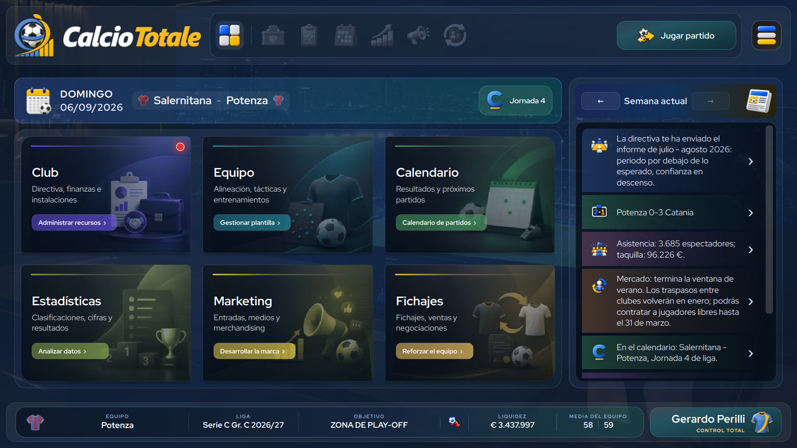
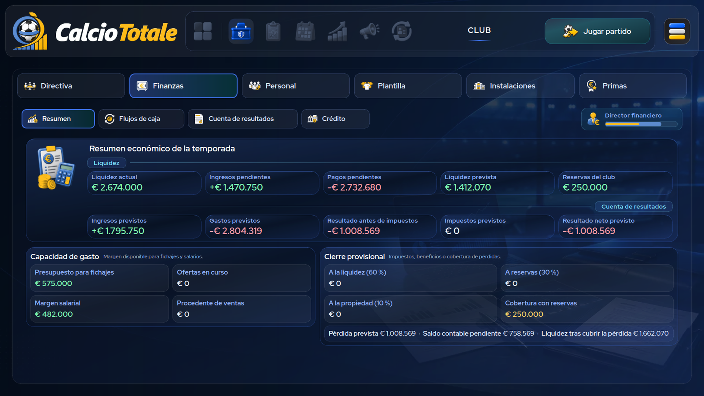
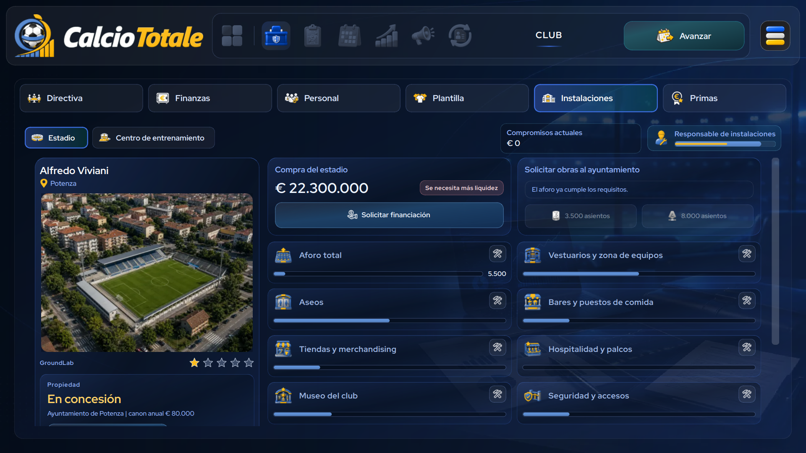
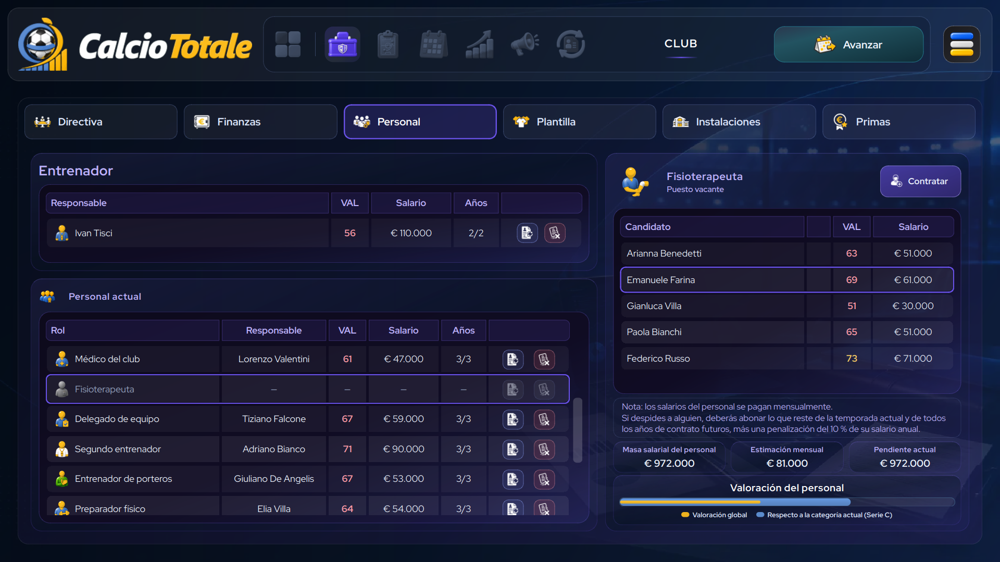
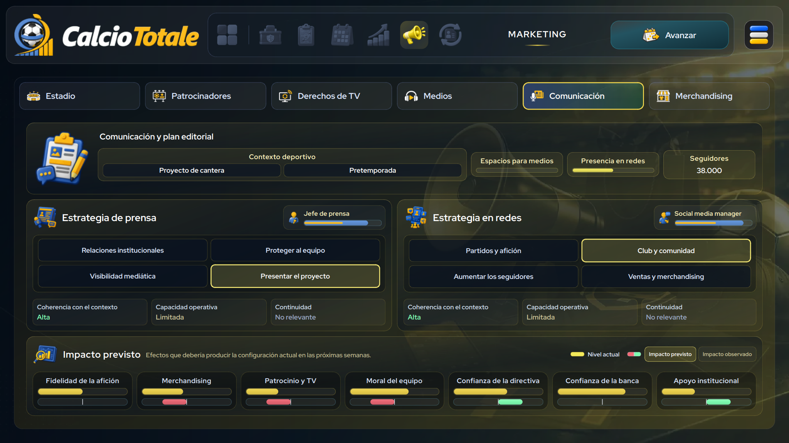
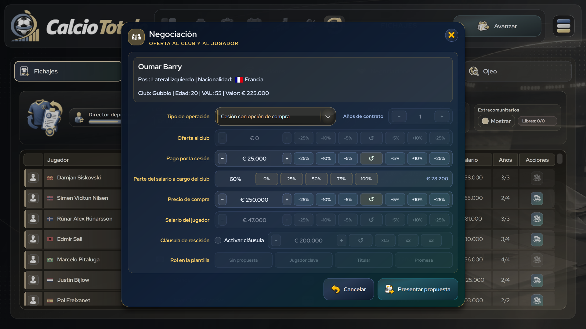
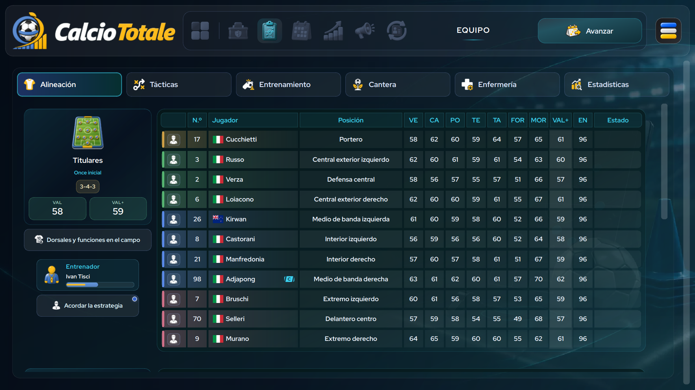
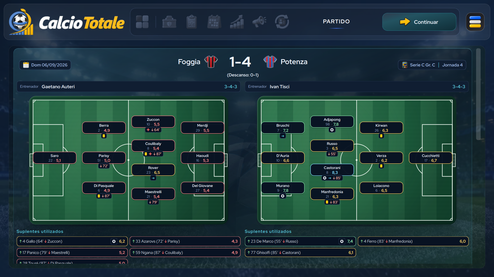
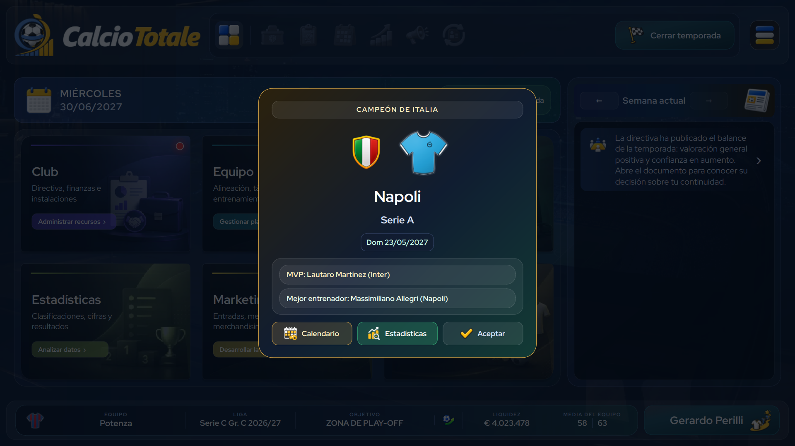
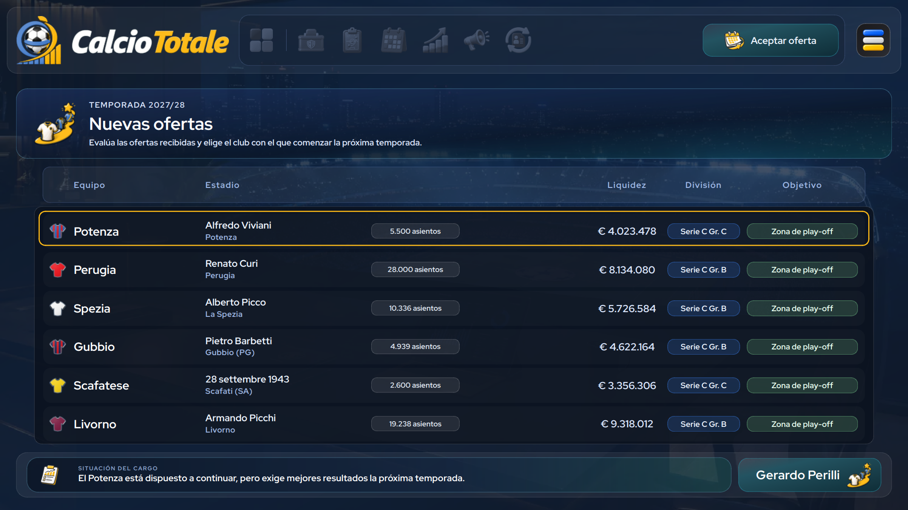

# Calcio Totale

[Versión italiana](README.it.md) · [English version](README.md)

## Descarga la demo

- [Windows x64](https://github.com/eleora-dev/calciototale/releases/download/v1.0.8/CalcioTotale-1.0.8-demo-windows-x64.zip)
- [Linux x86_64](https://github.com/eleora-dev/calciototale/releases/download/v1.0.8/CalcioTotale-1.0.8-demo-linux-x86_64.tar.gz)
- [macOS Apple Silicon](https://github.com/eleora-dev/calciototale/releases/download/v1.0.8/CalcioTotale-1.0.8-demo-macOS-arm64.zip)

La versión Mac requiere Apple Silicon (M1 o posterior) y macOS 13.3 o posterior. La app Mac está firmada y notarizada por Apple.


**Calcio Totale** es un juego de gestión futbolística para un solo jugador que recupera el espíritu de los clásicos del género desde otra perspectiva: en lugar de asumir el papel habitual de entrenador y mánager, diriges un club como director general. Define la estrategia de la entidad, construye una estructura sostenible y afronta las consecuencias deportivas y económicas de cada decisión.

La aplicación y el motor están desarrollados en C++17 con Qt Widgets nativo. La versión **1.0.8** incorpora mejoras de rendimiento, interfaz, cambio de temporada y base de datos en Windows, Linux y macOS. Las demos están disponibles en las versiones públicas de GitHub; la disponibilidad en Steam se gestiona por separado. La aplicación se distribuye junto con un paquete de datos futbolísticos sustituible, actualizado para la temporada **2026-27**.

> **Idiomas:** la interfaz está disponible en italiano, inglés y español.


### Inicio Qt nativo desde el código fuente

La aplicación y el motor usan C++17 y Qt Widgets.

```bash
cmake -S src -B build/desktop -DCMAKE_BUILD_TYPE=Release -DCT_PROJECT_ROOT="$PWD"
cmake --build build/desktop --target calciototale_owned --parallel 2
./build/desktop/calciototale_owned
```


---

<table>
  <tr>
    <td width="20%"><a href="assets/branding/screenshots/es/01_home_es.png"></a></td>
    <td width="20%"><a href="assets/branding/screenshots/es/02_finances_es.png"></a></td>
    <td width="20%"><a href="assets/branding/screenshots/es/03_facilities_es.png"></a></td>
    <td width="20%"><a href="assets/branding/screenshots/es/04_staff_es.png"></a></td>
    <td width="20%"><a href="assets/branding/screenshots/es/05_marketing_es.png"></a></td>
  </tr>
  <tr>
    <td width="20%"><a href="assets/branding/screenshots/es/06_transfer_es.png"></a></td>
    <td width="20%"><a href="assets/branding/screenshots/es/07_squad_es.png"></a></td>
    <td width="20%"><a href="assets/branding/screenshots/es/08_matchday_es.png"></a></td>
    <td width="20%"><a href="assets/branding/screenshots/es/09_verdict_es.png"></a></td>
    <td width="20%"><a href="assets/branding/screenshots/es/10_career_es.png"></a></td>
  </tr>
</table>

---

## Novedades de la 1.0.8

- **Rendimiento** — carga inicial de la carrera más rápida, avance de la carrera y operaciones de gestión optimizados, y mayor capacidad de respuesta de la interfaz.
- **Directiva y cambio de temporada** — comunicación oficial durante la primera semana de junio sobre la plantilla prevista, los contratos que vencen y los problemas económicos; tiempo para intervenir antes del cierre de temporada y evaluación de liquidez corregida para contemplar las operaciones confirmadas de final de temporada.
- **Alineación** — una descripción emergente con un campo en miniatura muestra todas las ubicaciones del esquema actual y destaca la del jugador; se distinguen expresamente el rol de referencia, la ubicación en el esquema y las posiciones naturales.
- **Terminología coherente** — términos unificados en perfiles, fichajes, negociaciones y pantallas técnicas en italiano, inglés y español.
- **Opciones de compra en cesiones** — controles del salario con ajustes porcentuales y la posibilidad de restablecer el salario inicial al ejercer la opción de compra.
- **Interfaz y base de datos** — correcciones gráficas y actualización con los cambios de entrenador más recientes. Los datos de temporada permanecen en `data/data.json.gz`; las actualizaciones de las plantillas se aplican a las carreras nuevas.

Consulta [roadmap.md](roadmap.md) para ver el plan de desarrollo y las comprobaciones pendientes.

## El juego

- **Dos modos de carrera** — *Siempre fiel* te vincula a un único club; *Camino a la gloria* sigue la trayectoria de un dirigente desde las categorías inferiores, con ofertas de otros clubes, evaluaciones de la directiva y la posibilidad de ser destituido.
- **Control técnico configurable** — si desactivas *Control total*, delegas las alineaciones, las tácticas, los entrenamientos y la dirección de los partidos en el cuerpo técnico, según su capacidad y el mandato recibido. Si lo activas, tomas personalmente todas las decisiones técnicas.
- **Cinco ligas jugables** — Serie A, Serie B y los tres grupos de Serie C. El paquete de datos de la temporada incluye 100 clubes italianos seleccionables y otros 145 clubes europeos e internacionales no seleccionables.
- **Fútbol nacional** — ligas, Coppa Italia, Coppa Italia Serie C, Supercoppa Italiana, play-offs y play-outs de Serie B y fase posterior a la liga de Serie C.
- **Competiciones internacionales** — UEFA Champions League, Europa League, Conference League, Supercopa de la UEFA, Copa Intercontinental y Mundial de Clubes, con eliminatorias de clasificación, sorteos, fases de liga y continuidad entre temporadas.
- **Gestión de la plantilla y los partidos** — sistemas de juego, alineaciones, tácticas, dorsales, roles, preparación de encuentros, entrenamiento semanal, lesiones, enfermedades, sanciones y crónicas de los partidos.
- **Gestión del club** — objetivos e informes de la directiva, flujos de caja, cuenta de resultados, contabilidad de traspasos, contratos, primas, crédito, ampliaciones de capital, personal, estadio y desarrollo del centro de entrenamiento, con renegociación del canon con el propietario del estadio.
- **Fichajes y ojeo** — incorporaciones, ventas, cesiones, negociaciones, precontratos, listas de transferibles y cedibles, seguimiento de futbolistas y búsqueda de jóvenes promesas.
- **Gestión comercial** — venta de entradas y abonos, patrocinadores, derechos televisivos, prensa y comunicados oficiales, redes sociales y productos del club.
- **Cantera y desarrollo** — jóvenes de la cantera, ascenso al primer equipo, evolución técnica, personalidad y seguimiento individual.
- **Estadísticas y noticias** — clasificaciones, calendarios, filtros por competición, informes de jugadores y equipos, premios, récords y noticias relacionadas con la partida.
- **Partidas guardadas localmente** — nueve espacios de guardado en la carpeta `user/`. Las versiones portátiles para Windows y Linux la mantienen junto al ejecutable; los paquetes de sistema utilizan la carpeta de datos del usuario y macOS utiliza `~/Library/Application Support/CalcioTotale/user/`.
- **Selección de idioma** — los catálogos de italiano, inglés y español comparten la misma estructura. El idioma inicial sigue la configuración del sistema y la elección manual se guarda localmente.

## Funcionamiento y privacidad

Calcio Totale es un juego de escritorio sin conexión:

- no crea ni requiere una cuenta propia ni un servidor gestionado por Eleòra;
- no utiliza telemetría, análisis de uso ni servicios publicitarios;
- durante el juego normal no realiza solicitudes de red;
- guarda las carreras en el dispositivo; en la edición de Steam, el cliente de Steam puede sincronizarlas si Steam Cloud está activado.

Los enlaces externos de la ventana «Información» abren el navegador predeterminado solo cuando se seleccionan. En ese caso, es el navegador quien se conecta al sitio enlazado, no el juego.

Los informes de errores se crean localmente en `user/diagnostics/`: versión, últimas acciones y datos técnicos; en Windows pueden incluir un minidump de la memoria del juego. Nunca se envían automáticamente. Tras un cierre inesperado, un proceso separado muestra un diálogo con «Enviar informe» y «Cerrar». Solo al pulsar «Enviar informe» se transmiten los datos de diagnóstico por HTTPS al proyecto Sentry de Eleòra, sin abrir el correo ni requerir una cuenta al jugador. Pueden contener fragmentos de datos y rutas locales; no se adjuntan partidas completas automáticamente. Se conservan como máximo cinco informes anteriores, además de la sesión activa.

Desde **Información → Informar de un error** puedes enviar un informe manual a Sentry. La descripción es obligatoria y el email es opcional. Solo al pulsar Enviar se comparten el texto, el email opcional, la versión del juego, el idioma y el sistema operativo; no se adjuntan partidas guardadas ni registros de diagnóstico. Si falla el envío, el texto permanece en el formulario para volver a intentarlo.

Consulta [privacy.html](privacy.html) para leer la política de privacidad completa, disponible en italiano e inglés.

## Descripción técnica

En la estructura del proyecto, **Calcio Totale** designa la aplicación. La carpeta `data/` completa constituye un paquete independiente y sustituible de contenido futbolístico. Se coloca junto a la aplicación para que esta pueda leerlo localmente, pero no forma parte del material propietario de Calcio Totale.

- `data/data.json.gz` contiene los datos de la temporada en JSON UTF-8 comprimido con gzip: 245 clubes, 6475 jugadores, nombres, abreviaturas, organizadores, colores y diseños de camisetas identificativas e identificadores neutros de los iconos de las competiciones.
- `assets/competitions/` contiene las ilustraciones genéricas y fijas de la aplicación. Los campos `icon`, `organizer_icon`, `trophy_icon` y `winter_champion_icon` de la base de datos seleccionan identificadores neutros (por ejemplo, `continental_cup_1`); cambiar los nombres u organizadores de las competiciones no cambia las imágenes ni su ubicación. Los artículos de las competiciones se declaran en `article_it` y `article_es` en la base de datos.
- Los nombres de competiciones, federaciones, organizadores, sedes y los grupos de nombres se leen de la base de datos actual; los textos traducibles se encuentran exclusivamente en los tres archivos de `locales/`.
- `src/app/` contiene la interfaz Qt Widgets y los controladores C++; Qt transforma en memoria las imágenes originales de `assets/`, con catálogos de presentación en `src/ui/`.
- `src/engine/domain/` contiene el estado y los modelos del juego, la simulación, los contratos, la gestión de la carrera y la persistencia en C++.
- `assets/` contiene la identidad gráfica, los fondos, los iconos de la interfaz, las banderas, las fuentes, las ilustraciones de las competiciones y otros recursos visuales.
- `user/` se crea durante la ejecución para las partidas guardadas y sus resúmenes.

El entorno de referencia es Fedora Linux con KDE Plasma. El código también incluye gestión de pantalla para Windows y macOS, pero solo deben considerarse compatibles las plataformas para las que se publique expresamente una versión oficial.


## Requisitos de la versión fuente

Se necesitan CMake 3.21+, un compilador C++17 y Qt SDK 6.7+ (Widgets, Svg, Network) con Widgets y plugins SVG. Windows requiere las herramientas C++ x64 de Visual Studio 2022; macOS usa Apple Clang. La superficie de juego de 1600 × 900 se escala automáticamente.

Usa `CALCIOTOTALE_DEMO=1` para iniciar la demo local. El empaquetado, la instalación del SDK Qt y el inventario de licencias también usan herramientas C++.

## Comprobaciones de desarrollo

Configura las pruebas con `cmake -S src -B build/desktop -DCT_DOMAIN_TESTS=ON -DCT_DEVELOPMENT_TOOLS=ON`, compila con `cmake --build build/desktop -j1` y ejecuta `ctest --test-dir build/desktop --output-on-failure -j1`. La suite de pruebas usa C++ y CTest para motor, catálogos, fixtures, directiva, mercado de entrenadores, persistencia, compatibilidad, auditorías GUI, empaquetado y flujos de publicación. El filtro `-L fast` excluye los recorridos GUI y el cambio completo de temporada; `-L full` incluye toda la suite. Selecciona un área funcional con `-L board`, `-L coaches`, `-L catalogues`, `-L persistence`, `-L gui`, `-L packaging` o `-L release`. Las pruebas de empaquetado verifican las herramientas C++ de producción; en Linux también se necesitan `cc`, `ldd` y `patchelf`. Las pruebas del instalador y de las licencias usan además `curl` y CMake con fixtures locales. No realizan cargas ni publicaciones. Las fixtures están versionadas en `dev/tests/fixtures/`; `.test-results/` solo contiene resultados regenerables y puede borrarse. La compatibilidad de partidas anteriores se verifica también con `build/desktop/ct_previous_careers run`, usando únicamente el juego C++ actual.

Las herramientas C++ para la base de datos y el importador se documentan en [dev/README.md](dev/README.md). Requieren también libxml2 y no se incluyen en el juego.

## Distribución

El repositorio del código fuente, `calciototale-src`, es privado. La versión completa se distribuye a través de [Steam](https://store.steampowered.com/app/5247020/Calcio_Totale/). El repositorio público [`calciototale`](https://github.com/eleora-dev/calciototale) distribuye exclusivamente los paquetes de la demo.

Las versiones ejecutables oficiales solo pueden descargarse, instalarse y utilizarse para uso personal y no comercial, de acuerdo con la [licencia](LICENSE). El acceso al código fuente, la redistribución, la modificación, la publicación y el uso comercial requieren autorización previa por escrito. No redistribuyas las versiones ejecutables ni recurras a sitios de descarga no oficiales.

El procedimiento para crear la versión portátil de Windows x64 se documenta en [build/windows/README.md](build/windows/README.md). Las versiones portátil de Linux x86_64 y RPM para Fedora se documentan en [build/linux/README.md](build/linux/README.md). El paquete `.app` para Apple Silicon, Mac con procesador Intel o Universal 2, incluida la firma y la notarización, se documenta en [build/macos/README.md](build/macos/README.md). Todos estos formatos generan un paquete autónomo con la aplicación, sus dependencias y el paquete de contenido independiente situado en `data/`.

El flujo de trabajo manual `Build Steam and demo packages` crea y verifica ambas ediciones para Windows x64 y Linux x86_64 en el entorno de Steam. Los paquetes completos permanecen como artefactos privados destinados a los depósitos de Steam. Cuando se solicita su publicación, solo los paquetes de la demo se suben a una versión publicada en el repositorio público [`calciototale`](https://github.com/eleora-dev/calciototale). La demo de macOS Apple Silicon se publica después de la firma Developer ID, la notarización de Apple y la verificación de los paquetes. Los paquetes RPM no forman parte de esta versión.


## Estructura del proyecto

```text
assets/                   Identidad gráfica, fondos, iconos, banderas, fuentes y recursos de interfaz
data/                     Paquete independiente y sustituible de contenido futbolístico
licenses/                 Textos de las licencias de componentes de terceros
src/app/                  Interfaz Qt Widgets y controladores C++17
src/ui/                   Diseños, estilos y definiciones de transformación Qt
locales/                  Textos del juego: it.json, en.json, es.json
src/engine/               Motor C++17, modelos, simulación, persistencia e interfaces C ABI
build/desktop/            Archivos generados y caché local de la biblioteca nativa
build/windows/            CMake / Qt y script PowerShell
build/linux/              Paquete Linux común, archivo portátil y paquete RPM
build/macos/              Paquete .app, firma, notarización y archivo ZIP
LICENSE                   Licencia propietaria de CalcioTotale
THIRD_PARTY_NOTICES.md    Componentes y recursos de terceros y sus derechos
privacy.html              Política de privacidad en italiano e inglés
user/                     Partidas, resúmenes y preferencias locales; se crea cuando es necesario
```

## Licencia y derechos de terceros

El código original de Calcio Totale, su documentación y los recursos originales de la aplicación son propietarios; todos los derechos están reservados. La carpeta `data/` completa es un paquete de contenido independiente y queda excluida de la licencia propietaria. Consulta [LICENSE](LICENSE).

Los componentes y materiales de terceros siguen sujetos a sus respectivas licencias, condiciones y titulares de derechos. El repositorio documenta en particular:

- **miniz** — licencia MIT; compresión y descompresión de la base de datos y las partidas guardadas;
- **Datos Unicode** — Unicode License V3; tablas de procesamiento de texto utilizadas por el modelo C++;
- **Algoritmos MT19937 / CPython** — avisos BSD/PSF para los algoritmos adaptados a C++;
- **Qt y códecs de imagen** — bibliotecas nativas compartidas; licencias de los módulos y avisos incluidos en `licenses/qt/6.11.2/`;
- **Runtime Microsoft C++** — las DLL de Windows conservan los términos de Microsoft;
- **Google Material Symbols / Material Design icons** — licencia Apache 2.0 para los iconos derivados a los que corresponda;
- **Red Hat Display** — SIL Open Font License 1.1; se utiliza en la interfaz y en los textos del tráiler;
- **Oxanium** — SIL Open Font License 1.1; se utiliza para los patrocinadores de las camisetas y los títulos del tráiler;
- **flag-icons** — licencia MIT para las banderas SVG a las que corresponda;
- **Kenney Cursor Pack** — licencia CC0 1.0 para los cursores de flecha, mano, ayuda y texto;
- **paquete `data/`** — su base de datos y las imágenes de las competiciones son independientes de la aplicación; los derechos correspondientes siguen perteneciendo a sus respectivos titulares.

Consulta [THIRD_PARTY_NOTICES.md](THIRD_PARTY_NOTICES.md) y la carpeta [`licenses/`](licenses/). Calcio Totale es un proyecto no oficial: no está afiliado a ninguna federación, liga, competición, club, jugador o proveedor de datos, ni cuenta con su aprobación o patrocinio.

## Autor

Gerardo Perilli · [Eleòra](https://github.com/eleora-dev)
