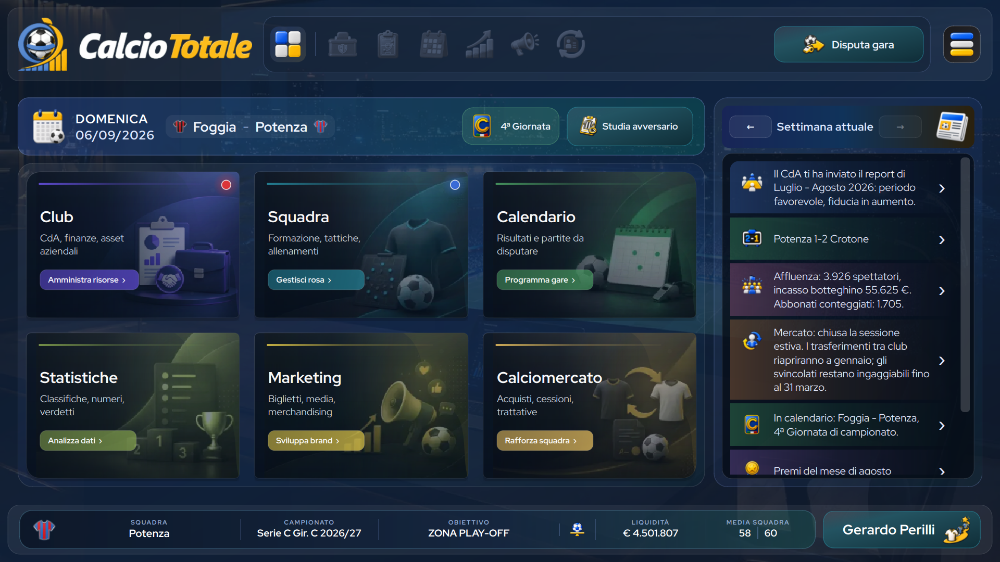
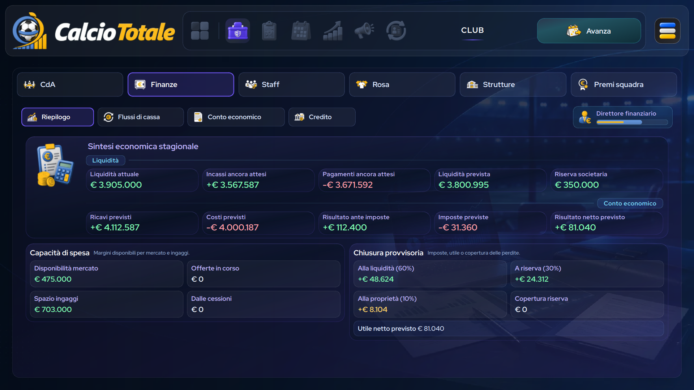
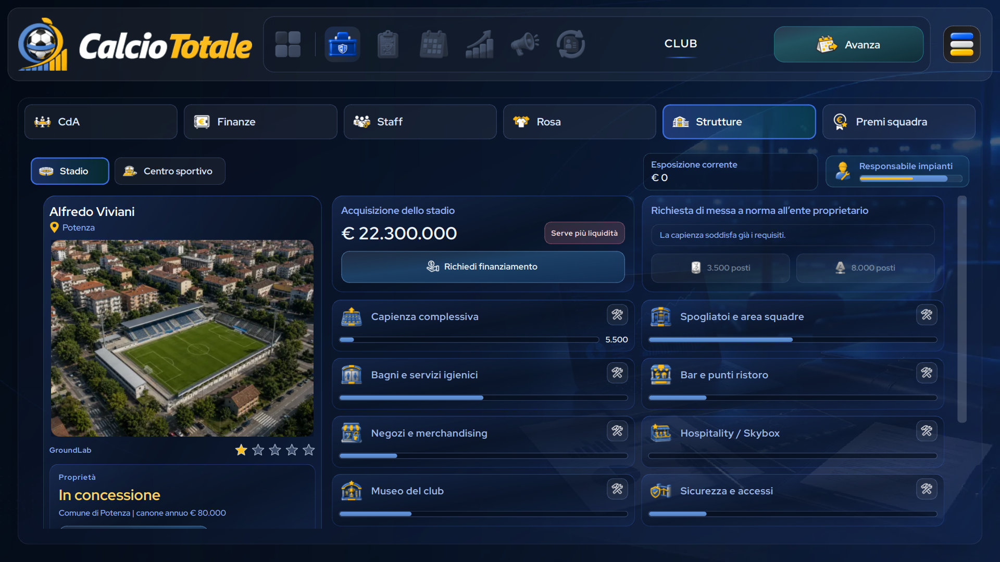
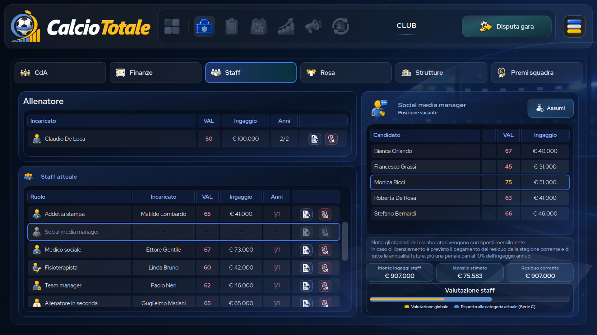
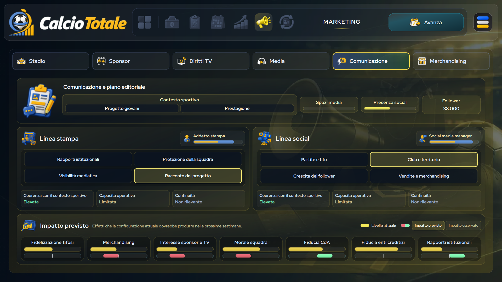
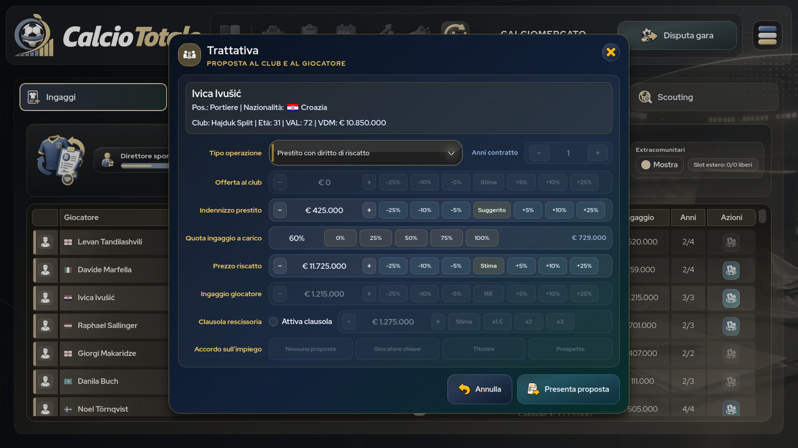
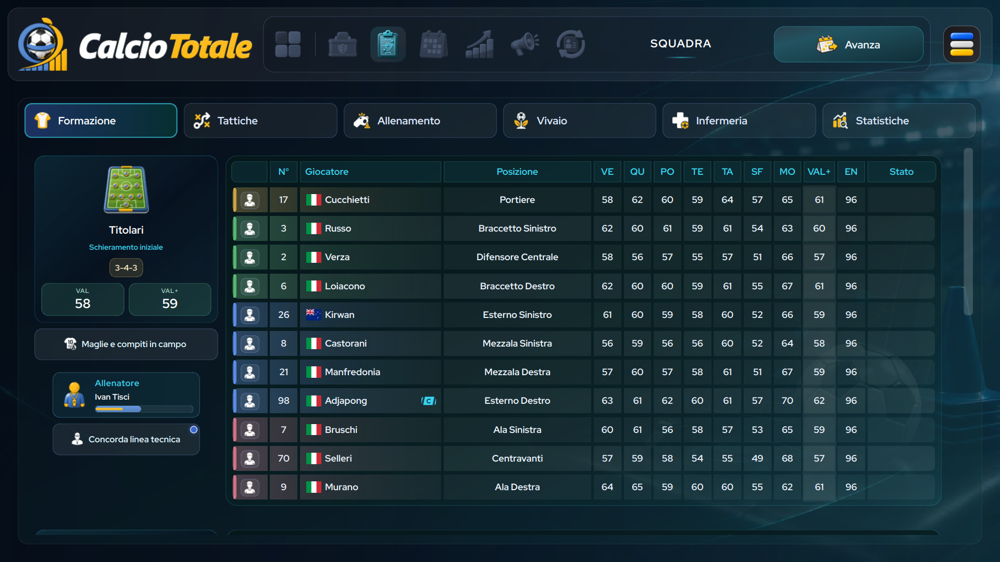
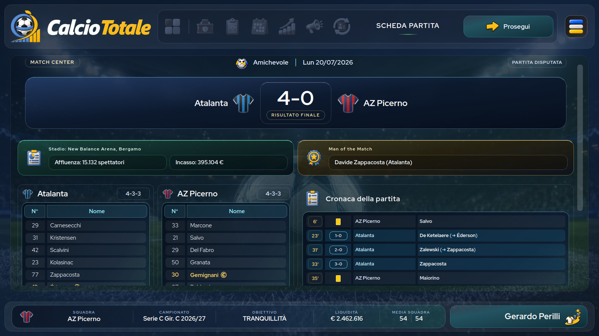
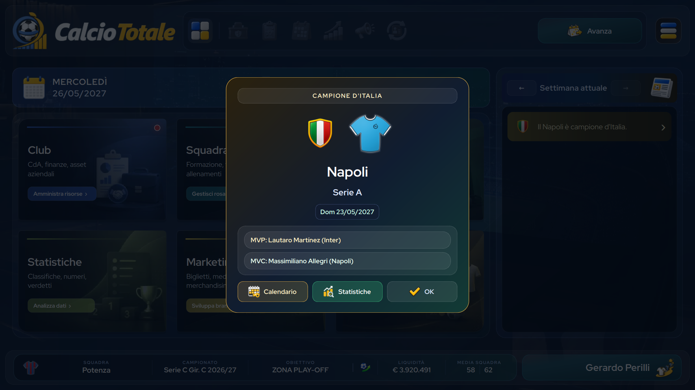
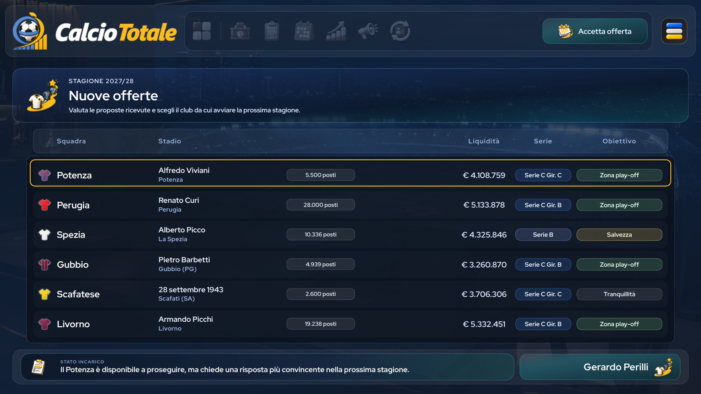

# Calcio Totale

[English version](README.md) · [Versión española](README.es.md)

**Calcio Totale** è un gestionale calcistico per giocatore singolo che riprende lo spirito dei classici del genere, ma cambiandone il punto di vista: non interpreti più il tradizionale allenatore-manager, bensì l’amministratore delegato di un club. Definisci la strategia della società, costruisci una struttura sostenibile e affronta le conseguenze sportive ed economiche di ogni decisione.

L'applicazione e il motore sono sviluppati in C++17 con Qt Widgets nativo. La versione **1.0.8** introduce miglioramenti delle prestazioni, dell’interfaccia, della gestione di fine stagione e del database su Windows e Linux. Le demo sono disponibili nelle release pubbliche GitHub; la disponibilità su Steam viene gestita separatamente. L'applicazione è accompagnata da un pacchetto di contenuti calcistici sostituibile aggiornato alla stagione **2026-27**.

> **Lingue:** interfaccia disponibile in italiano, inglese e spagnolo.


### Avvio Qt nativo dai sorgenti

Il gioco e il motore sono C++17 con Qt Widgets.

```bash
cmake -S src -B build/desktop -DCMAKE_BUILD_TYPE=Release -DCT_PROJECT_ROOT="$PWD"
cmake --build build/desktop --target calciototale_owned --parallel 2
./build/desktop/calciototale_owned
```


---

<table>
  <tr>
    <td width="20%"><a href="assets/branding/screenshots/it/01_home_it.png"></a></td>
    <td width="20%"><a href="assets/branding/screenshots/it/02_finances_it.png"></a></td>
    <td width="20%"><a href="assets/branding/screenshots/it/03_facilities_it.png"></a></td>
    <td width="20%"><a href="assets/branding/screenshots/it/04_staff_it.png"></a></td>
    <td width="20%"><a href="assets/branding/screenshots/it/05_marketing_it.png"></a></td>
  </tr>
  <tr>
    <td width="20%"><a href="assets/branding/screenshots/it/06_transfer_it.png"></a></td>
    <td width="20%"><a href="assets/branding/screenshots/it/07_squad_it.png"></a></td>
    <td width="20%"><a href="assets/branding/screenshots/it/08_matchday_it.png"></a></td>
    <td width="20%"><a href="assets/branding/screenshots/it/09_verdict_it.png"></a></td>
    <td width="20%"><a href="assets/branding/screenshots/it/10_career_it.png"></a></td>
  </tr>
</table>

---

## Novità della 1.0.8

- **Prestazioni** — caricamento iniziale della carriera più rapido, avanzamenti e operazioni di gestione ottimizzati, maggiore reattività dell’interfaccia.
- **CdA e cambio stagione** — comunicazione ufficiale del Consiglio nella prima settimana di giugno, con indicazioni sulla rosa prevista, sui contratti in scadenza e sulle criticità economiche; tempo utile per intervenire prima della chiusura stagionale e verifica della liquidità corretta per le operazioni certe di fine stagione.
- **Formazione** — tooltip con un piccolo campo che mostra tutti gli slot del modulo attuale ed evidenzia la collocazione del calciatore; ruolo di riferimento, collocazione nel modulo e posizioni naturali sono distinti esplicitamente.
- **Diciture coerenti** — terminologia uniformata nei profili, nel Mercato, nelle trattative e nelle schermate tecniche, in italiano, inglese e spagnolo.
- **Riscatto dei prestiti** — controllo dell’ingaggio con variazioni percentuali e ripristino del valore iniziale per i prestiti con diritto di riscatto.
- **Interfaccia e database** — correzioni grafiche e aggiornamento ai cambi di allenatore più recenti. I dati stagionali restano in `data/data.json.gz`; gli aggiornamenti delle rose riguardano le nuove carriere.

Per il piano di sviluppo e le verifiche ancora aperte, vedere [roadmap.md](roadmap.md).

## Il gioco

- **Due modalità carriera** — *Solo la Maglia* lega il giocatore a un unico club, mentre *Sentieri di Gloria* segue la carriera di un dirigente dalle serie inferiori attraverso offerte, valutazioni e possibili revoche dell'incarico.
- **Controllo tecnico configurabile** — quando *Controllo totale* non è attivo, formazione, tattiche, allenamento e gestione della gara sono delegati allo staff tecnico secondo qualità e mandato assegnato; attivandolo, ogni scelta tecnica passa direttamente al giocatore.
- **Cinque campionati giocabili** — Serie A, Serie B e tutti e tre i gironi di Serie C, con 100 club italiani selezionabili e altri 145 club europei e internazionali non selezionabili nel pacchetto stagionale fornito.
- **Calcio nazionale** — campionati, Coppa Italia, Coppa Italia Serie C, Supercoppa Italiana, play-off e play-out di Serie B e fase post-campionato di Serie C.
- **Competizioni internazionali** — UEFA Champions League, Europa League, Conference League, Supercoppa UEFA, Coppa Intercontinentale e Mondiale per Club, con play-off di qualificazione, sorteggi, fasi campionato e progressione tra le stagioni.
- **Gestione della squadra e delle partite** — moduli, formazioni, tattiche, numeri di maglia, ruoli, preparazione della gara, allenamento settimanale, infortuni, malattie, squalifiche e cronache delle partite.
- **Gestione societaria** — obiettivi e relazioni della dirigenza, flussi di cassa, conto economico, contabilità dei cartellini, contratti, premi, credito, ricapitalizzazioni, staff, stadio e sviluppo del centro di allenamento, con rinegoziazione del canone con l’ente proprietario.
- **Calciomercato e osservazione** — acquisti, cessioni, prestiti, trattative, precontratti, liste in uscita, giocatori osservati e ricerca di giovani talenti.
- **Gestione commerciale** — biglietteria e abbonamenti, sponsor, diritti televisivi, stampa e comunicazione ufficiale, canali social e merchandising.
- **Settore giovanile e crescita** — giovani del vivaio, percorsi di promozione, sviluppo tecnico, personalità e gestione individuale.
- **Statistiche e notizie** — classifiche, calendari, filtri per competizione, rapporti su giocatori e squadre, premi, record e notizie contestuali.
- **Salvataggi locali** — nove slot carriera nella cartella locale `user/`; le build portabili Windows e Linux la mantengono accanto all'eseguibile, i pacchetti di sistema usano la cartella dati dell'utente e macOS usa `~/Library/Application Support/CalcioTotale/user/`.
- **Tre lingue per l'interfaccia** — italiano, inglese e spagnolo condividono la stessa struttura di localizzazione; la lingua predefinita segue il sistema e la scelta manuale viene conservata localmente.

## Funzionamento e privacy

Calcio Totale è un gioco desktop offline:

- non crea né richiede un proprio account o un server gestito da Eleòra;
- non utilizza telemetria, sistemi di analisi o servizi pubblicitari;
- durante il normale utilizzo non effettua richieste di rete;
- i dati delle carriere vengono salvati localmente; nell'edizione Steam possono essere sincronizzati dal client Steam quando Steam Cloud è abilitato.

I collegamenti nella finestra Informazioni aprono il browser predefinito soltanto quando vengono selezionati; l'eventuale connessione viene effettuata dal browser verso il sito collegato, non dal gioco.

I rapporti degli errori vengono creati localmente in `user/diagnostics/`: versione della build, ultime operazioni e dati tecnici; su Windows può essere incluso un minidump della memoria del gioco. Non vengono inviati automaticamente. Dopo un crash, un processo separato mostra una finestra con «Invia rapporto» e «Chiudi». Solo premendo «Invia rapporto» i dati diagnostici vengono trasmessi via HTTPS al progetto Sentry di Eleòra, senza aprire la posta o richiedere un account al giocatore. I rapporti possono contenere frammenti di dati e percorsi locali; non allegano automaticamente salvataggi completi. Sono conservati al massimo cinque rapporti precedenti, oltre alla sessione attiva.

Consulta [privacy.html](privacy.html) per l'informativa sulla privacy completa in italiano e inglese.

## Panoramica tecnica

Nella struttura del progetto, **Calcio Totale** indica l'applicazione, mentre l'intera cartella `data/` costituisce un pacchetto di contenuti calcistici separato e sostituibile. Il pacchetto viene collocato accanto all'applicazione perché possa essere letto localmente, ma non fa parte del materiale proprietario di Calcio Totale.

- `data/data.json.gz` contiene i dati stagionali in formato JSON UTF-8 compresso con gzip: 245 club, 6.475 giocatori, nomi, abbreviazioni, organizzatori, colori e schemi delle magliette identificative e identificatori neutri delle icone delle competizioni.
- `assets/competitions/` contiene le illustrazioni generiche e fisse dell’applicazione. I campi `icon`, `organizer_icon`, `trophy_icon` e `winter_champion_icon` del database scelgono identificatori neutri (per esempio `continental_cup_1`); modificare nomi o organizzatori delle competizioni non cambia le immagini né la loro posizione. Gli articoli grammaticali delle competizioni sono dichiarati nel database in `article_it` e `article_es`.
- Nomi di competizioni, federazioni, organizzatori, sedi e bacini di nomi sono letti dal database corrente; i testi traducibili restano esclusivamente nei tre file di `locales/`.
- `src/app/` contiene l’interfaccia Qt Widgets e i controller C++; Qt trasforma in memoria le immagini originali di `assets/`, con cataloghi di presentazione in `src/ui/`.
- `src/engine/domain/` contiene stato e modelli del gioco, simulazione, contratti, gestione della carriera e persistenza in C++.
- `assets/` contiene elementi grafici del progetto, sfondi, icone dell'interfaccia, bandiere, font, illustrazioni delle competizioni e altre risorse visive.
- `user/` viene creata durante l'esecuzione per gli slot di salvataggio e i relativi riepiloghi.

L'ambiente di riferimento è Fedora Linux con KDE Plasma. Il sorgente comprende anche la gestione dello schermo per Windows e macOS, ma devono essere considerate supportate soltanto le piattaforme per le quali viene pubblicata esplicitamente una build ufficiale.


## Requisiti della versione sorgente

Servono CMake 3.21+, un compilatore C++17 e Qt SDK 6.7+ (Widgets, Svg, Network) con Widgets e plugin SVG. Su Windows occorrono gli strumenti C++ x64 di Visual Studio 2022; su macOS Apple Clang. La superficie di gioco è 1600 × 900, con ridimensionamento automatico.

Per la demo locale si può impostare `CALCIOTOTALE_DEMO=1` all'avvio. Anche packaging, installazione dell’SDK Qt e inventario delle licenze sono gestiti da strumenti C++.

## Verifiche di sviluppo

I test si configurano con `cmake -S src -B build/desktop -DCT_DOMAIN_TESTS=ON -DCT_DEVELOPMENT_TOOLS=ON`, si compilano con `cmake --build build/desktop -j1` e si eseguono con `ctest --test-dir build/desktop --output-on-failure -j1`. La suite dei test usa C++ e CTest per motore, cataloghi, fixture, CdA, mercato allenatori, persistenza, compatibilità, audit GUI, packaging e pipeline di rilascio. Il filtro `-L fast` esclude i percorsi GUI e il cambio stagione completo; `-L full` include l’intera suite. Per selezionare un'area funzionale usare `-L board`, `-L coaches`, `-L catalogues`, `-L persistence`, `-L gui`, `-L packaging` o `-L release`. I test di packaging verificano gli strumenti C++ di produzione; su Linux servono anche `cc`, `ldd` e `patchelf`. I test dell’installer e delle licenze usano inoltre `curl` e CMake con fixture locali. Non eseguono caricamenti o pubblicazioni. Le fixture sono versionate in `dev/tests/fixtures/`; `.test-results/` contiene soltanto risultati rigenerabili e può essere cancellata. La compatibilità dei salvataggi precedenti si verifica anche con `build/desktop/ct_previous_careers run`, usando esclusivamente il gioco C++ attuale.

Gli strumenti C++ per il database e l’importer sono descritti in [dev/README.md](dev/README.md). Richiedono anche libxml2; non sono inclusi nei pacchetti del gioco.

## Distribuzione

Il repository dei sorgenti `calciototale-src` è privato. La versione completa è distribuita tramite [Steam](https://store.steampowered.com/app/5247020/Calcio_Totale/), mentre il repository pubblico [`calciototale`](https://github.com/eleora-dev/calciototale) distribuisce esclusivamente i pacchetti della versione demo.

Le build eseguibili ufficiali possono essere scaricate, installate e utilizzate esclusivamente per uso personale e non commerciale, secondo quanto stabilito nella [licenza](LICENSE). L'accesso ai sorgenti, la redistribuzione, la modifica, la pubblicazione e l'uso commerciale richiedono una preventiva autorizzazione scritta. Non redistribuire le build e non affidarti a mirror non ufficiali.

La procedura per la build portabile Windows x64 è documentata in [build/windows/README.md](build/windows/README.md). Le build Linux x86_64 portabile e RPM per Fedora sono documentate in [build/linux/README.md](build/linux/README.md). Il bundle `.app` per Apple Silicon, Mac Intel o Universal 2, con firma e notarizzazione, è documentato in [build/macos/README.md](build/macos/README.md). Tutti i formati producono un pacchetto autonomo composto dall'applicazione, dalle sue dipendenze e dal pacchetto di contenuti separato collocato in `data/`.

Il workflow manuale `Build Steam and demo packages` costruisce e verifica entrambe le edizioni per Windows x64 e Linux x86_64 nel runtime Steam. I pacchetti completi restano artefatti privati destinati ai depot Steam; quando viene richiesta la pubblicazione, soltanto i pacchetti demo vengono caricati nella release pubblica di [`calciototale`](https://github.com/eleora-dev/calciototale). Le build macOS e RPM restano disponibili come procedure manuali, ma sono escluse dalla distribuzione corrente.


## Struttura del progetto

```text
assets/                   Identità grafica, sfondi, icone, bandiere, font e risorse UI
data/                     Pacchetto separato e sostituibile di contenuti calcistici
licenses/                 Testi delle licenze dei componenti di terze parti
src/app/                  Interfaccia Qt Widgets e controller C++17
src/ui/                   Layout, stili e definizioni delle trasformazioni Qt
locales/                  Testi del gioco: it.json, en.json, es.json
src/engine/               Motore C++17, modelli, simulazione, persistenza e interfacce C ABI
build/desktop/            File generati dalle build e cache locale della libreria nativa
build/windows/            CMake / Qt e script PowerShell di build
build/linux/              Payload Linux, archivio portabile e pacchetto RPM
build/macos/              Bundle .app, firma, notarizzazione e archivio ZIP
LICENSE                   Licenza proprietaria di CalcioTotale
THIRD_PARTY_NOTICES.md    Componenti, risorse e diritti di terze parti
privacy.html              Informativa sulla privacy in italiano e inglese
user/                     Salvataggi, riepiloghi e preferenze locali, creati quando necessari
```

## Licenza e diritti di terze parti

Il codice originale di Calcio Totale, la documentazione e le risorse originali dell'applicazione sono proprietari e tutti i diritti sono riservati. L'intera cartella `data/` è un pacchetto di contenuti separato ed è esclusa dalla licenza proprietaria. Consulta [LICENSE](LICENSE).

I componenti e i materiali di terze parti rimangono soggetti alle rispettive licenze, condizioni e titolarità. Il repository documenta in particolare:

- **miniz** — licenza MIT; compressione e decompressione del database e dei salvataggi;
- **Dati Unicode** — Unicode License V3; tabelle usate dal modello C++ per le operazioni sui testi;
- **Algoritmi MT19937 / CPython** — attribuzioni BSD/PSF per gli algoritmi adattati in C++;
- **Qt e codec immagine** — librerie native condivise; licenze dei moduli e attribuzioni incluse in `licenses/qt/6.11.2/`;
- **Runtime Microsoft C++** — le DLL Windows conservano i termini Microsoft;
- **Google Material Symbols / Material Design icons** — licenza Apache 2.0 per le icone derivate applicabili;
- **Red Hat Display** — SIL Open Font License 1.1, usato per l'interfaccia e i testi del trailer;
- **Oxanium** — SIL Open Font License 1.1, usato per gli sponsor sulle maglie e i titoli del trailer;
- **flag-icons** — licenza MIT per le bandiere SVG applicabili;
- **Kenney Cursor Pack** — licenza CC0 1.0 per freccia, manina, help e cursore di testo;
- **pacchetto `data/`** — database e immagini delle competizioni costituiscono contenuti separati dall'applicazione; i relativi diritti rimangono ai rispettivi titolari.

Consulta [THIRD_PARTY_NOTICES.md](THIRD_PARTY_NOTICES.md) e la directory [`licenses/`](licenses/). Calcio Totale è un progetto non ufficiale e non è affiliato, approvato o sponsorizzato da federazioni, leghe, competizioni, club, giocatori o fornitori di dati.

## Autore

Gerardo Perilli · [Eleòra](https://github.com/eleora-dev)
