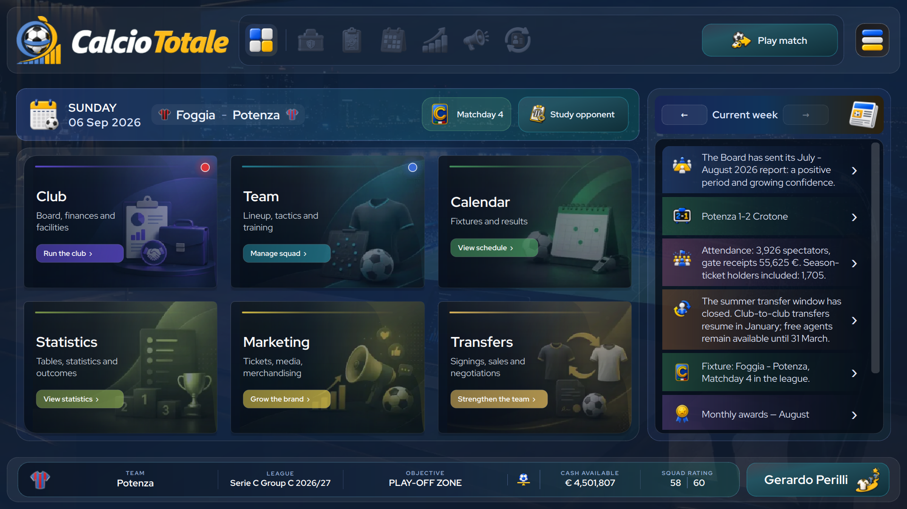
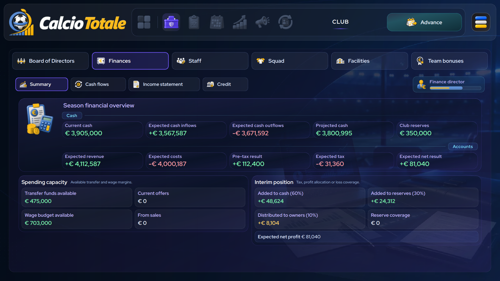
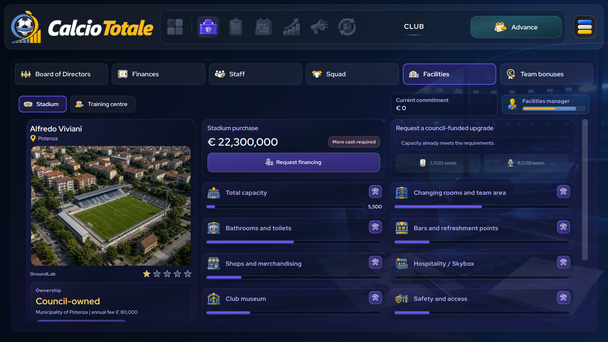
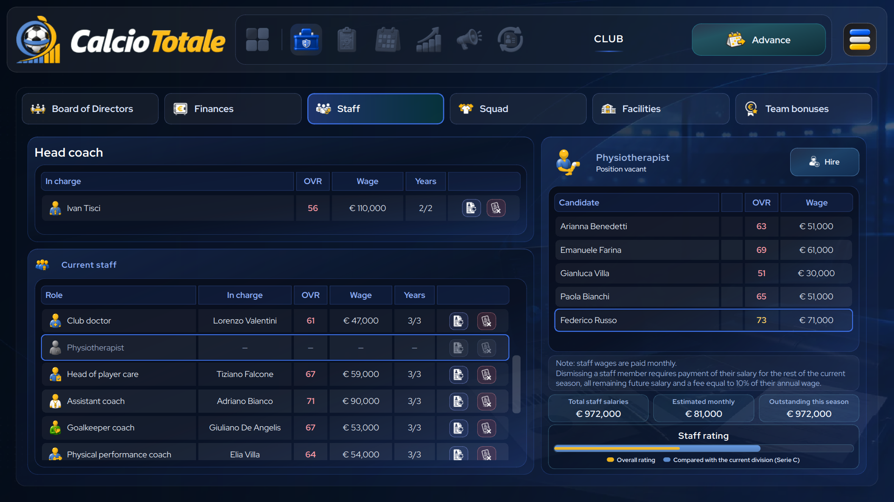
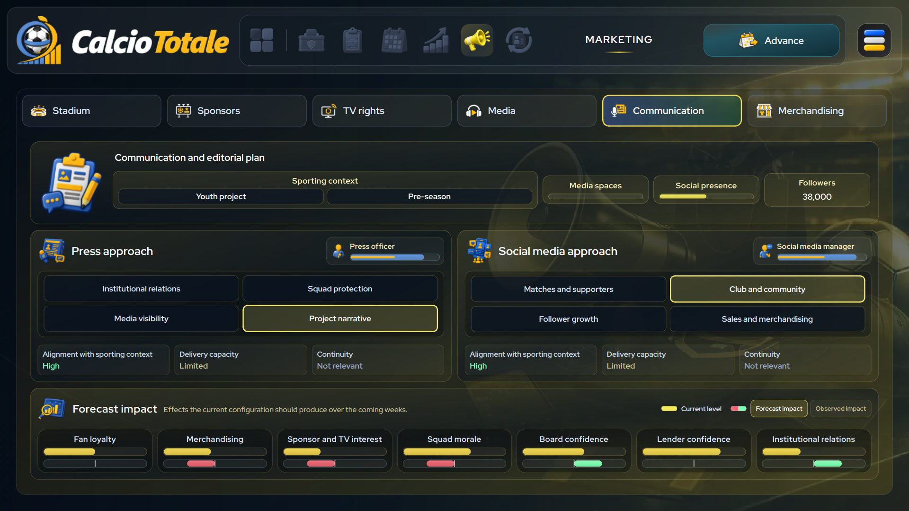
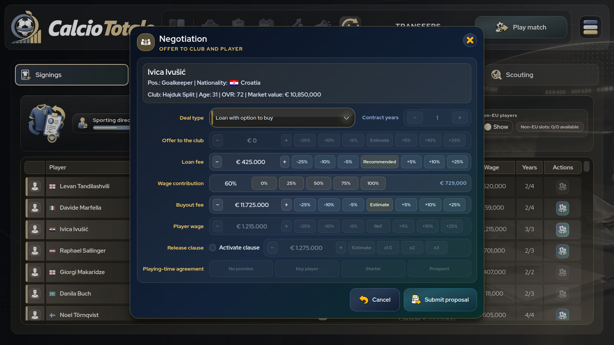
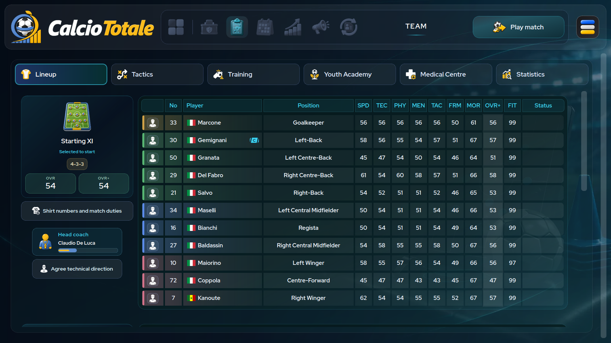
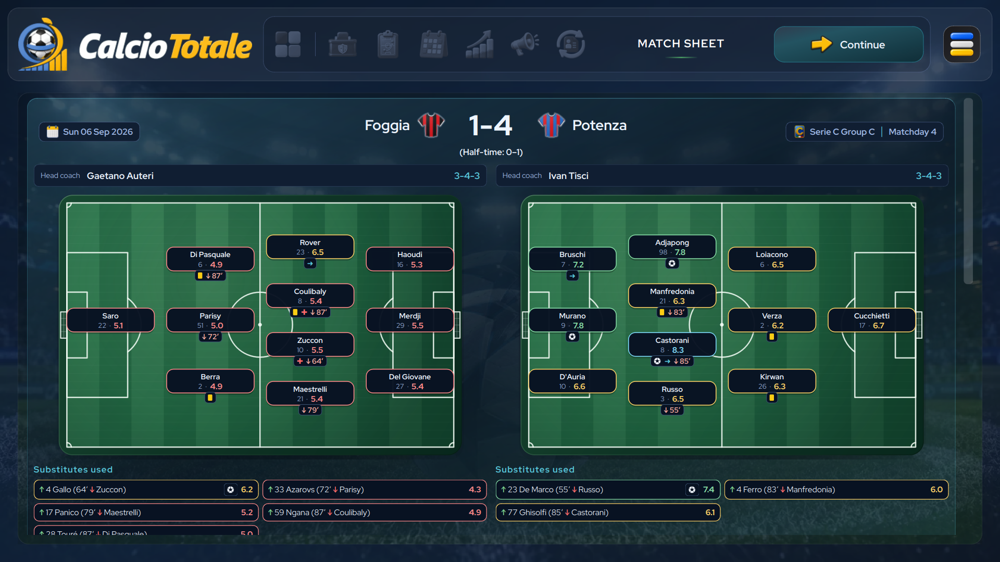
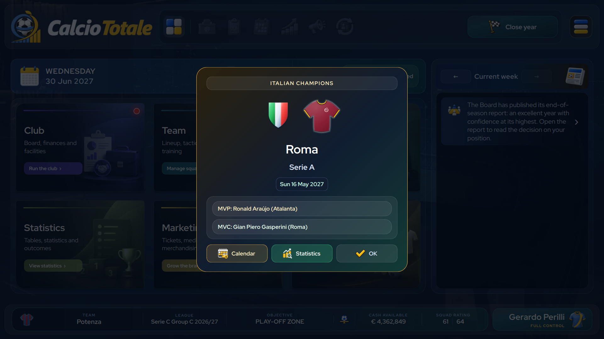
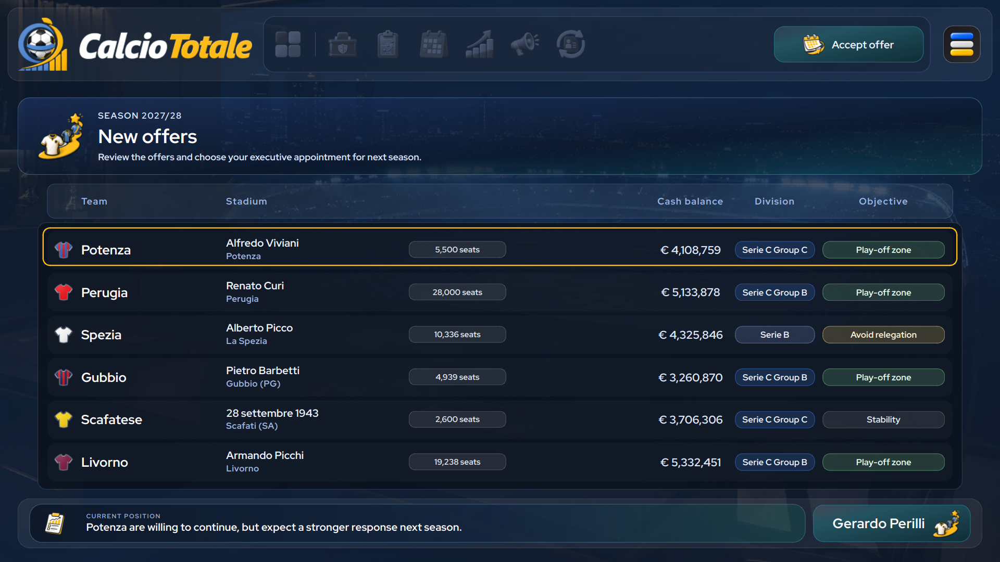

# Calcio Totale

[Versione italiana](README.it.md) · [Versión española](README.es.md)

**Calcio Totale** is a single-player football management game that captures the spirit of the genre's classics while shifting the perspective: you no longer play the traditional manager, but the club's chief executive. Define the club's strategy, build a sustainable organisation and face the sporting and financial consequences of every decision.

The application and game engine are built with C++17 and native Qt Widgets. Version **1.0.8** brings performance, interface, season-transition and database improvements to Windows and Linux. Demo downloads are available from the public GitHub releases; Steam availability is managed separately. The application is accompanied by a replaceable **2026-27** football content package.

> **Languages:** the interface is available in Italian, English and Spanish.


### Native Qt launch from source

The application and game engine use C++17 and Qt Widgets.

```bash
cmake -S src -B build/desktop -DCMAKE_BUILD_TYPE=Release -DCT_PROJECT_ROOT="$PWD"
cmake --build build/desktop --target calciototale_owned --parallel 2
./build/desktop/calciototale_owned
```


---

<table>
  <tr>
    <td width="20%"><a href="assets/branding/screenshots/en/01_home_en.png"></a></td>
    <td width="20%"><a href="assets/branding/screenshots/en/02_finances_en.png"></a></td>
    <td width="20%"><a href="assets/branding/screenshots/en/03_facilities_en.png"></a></td>
    <td width="20%"><a href="assets/branding/screenshots/en/04_staff_en.png"></a></td>
    <td width="20%"><a href="assets/branding/screenshots/en/05_marketing_en.png"></a></td>
  </tr>
  <tr>
    <td width="20%"><a href="assets/branding/screenshots/en/06_transfer_en.png"></a></td>
    <td width="20%"><a href="assets/branding/screenshots/en/07_squad_en.png"></a></td>
    <td width="20%"><a href="assets/branding/screenshots/en/08_matchday_en.png"></a></td>
    <td width="20%"><a href="assets/branding/screenshots/en/09_verdict_en.png"></a></td>
    <td width="20%"><a href="assets/branding/screenshots/en/10_career_en.png"></a></td>
  </tr>
</table>

---

## What’s new in 1.0.8

- **Performance** — faster initial career loading, optimised career progression and management operations, and improved interface responsiveness.
- **Board and season transition** — an official Board communication during the first week of June covers the projected squad, expiring contracts and financial concerns; time to address issues before the season closes and a corrected cash assessment accounting for confirmed season-end transactions.
- **Lineup** — a tooltip with a miniature pitch shows all slots in the current formation and highlights the player’s position; reference role, position in formation and natural positions are explicitly distinguished.
- **Consistent wording** — terminology aligned across player profiles, transfers, negotiations and technical screens in Italian, English and Spanish.
- **Loan purchase options** — wage controls with percentage adjustments and the ability to restore the initial wage when exercising an option to buy.
- **Interface and database** — graphical fixes and updates covering the latest managerial changes. Seasonal data remains in `data/data.json.gz`; roster updates apply to new careers.

See [roadmap.md](roadmap.md) for the development plan and outstanding checks.

## Current game

- **Two career modes** — *One Shirt* keeps the player at one club, while *Path to Glory* follows a director's career from the lower divisions through executive offers, board assessments and possible revocations of appointment.
- **Configurable technical control** — when *Total control* is disabled, line-ups, tactics, training and match management are delegated to the technical staff according to its quality and assigned mandate; enabling it gives every technical decision directly to the player.
- **Five playable leagues** — Serie A, Serie B and all three Serie C groups, with 100 selectable Italian clubs plus 145 non-selectable European and world-pool clubs in the supplied seasonal content package.
- **Domestic football** — league seasons, Coppa Italia, Coppa Italia Serie C, Supercoppa Italiana, Serie B play-offs/play-outs and Serie C post-season.
- **International competitions** — UEFA Champions League, Europa League, Conference League, UEFA Super Cup, Intercontinental Cup and Club World Cup, with qualifying play-offs, draws, league phases and season-to-season progression.
- **Squad and match management** — formations, line-ups, tactics, shirt numbers, player roles, match preparation, weekly training, injuries, illnesses, suspensions and match reports.
- **Club management** — board objectives and reports, cash flows, income statement, player-registration accounting, contracts, team bonuses, credit, recapitalisation, staff, stadium and training-centre development, and stadium-rent renegotiation with the owner.
- **Transfers and scouting** — signings, sales, loans, negotiations, pre-contracts, transfer and loan lists, watched players and youth recruitment.
- **Commercial management** — ticketing and season tickets, sponsors, TV rights, press and official communication, social channels and merchandising.
- **Youth and development** — academy prospects, promotion paths, technical growth, personalities and individual treatment.
- **Statistics and news** — tables, calendars, competition filters, player and team reports, awards, records and contextual news.
- **Local saves** — nine career slots stored in the local `user/` directory; portable Windows and Linux builds keep it beside the executable, system packages use the user's data directory, and macOS uses `~/Library/Application Support/CalcioTotale/user/`.
- **Three interface languages** — Italian, English and Spanish use matching localisation catalogues; the default follows the system language and a manual choice is stored locally.

## Runtime and privacy

Calcio Totale is an offline desktop game:

- it does not create or require its own account or an Eleòra-operated server;
- it does not use telemetry, analytics or advertising services;
- normal gameplay does not make network requests;
- career data is saved locally; in the Steam edition it may be synchronised by the Steam client when Steam Cloud is enabled.

The links in the About dialog open the user's default browser only when selected; any resulting connection is made by that browser to the linked website, not by the game runtime.

Error reports are created locally under `user/diagnostics/`: build version, recent actions and technical data; on Windows a minidump of game memory may be included. They are never uploaded automatically. After a crash, a separate process displays a dialog with “Send report” and “Close”. Only clicking “Send report” transmits diagnostic data over HTTPS to Eleòra’s Sentry project, without opening an email client or requiring a player account. Reports may contain data fragments and local paths; complete saves are not attached automatically. At most five previous reports are retained, in addition to the active session.

See [privacy.html](privacy.html) for the complete bilingual privacy policy.

## Technical overview

Within the project structure, **Calcio Totale** means the application, while the entire `data/` directory is a separate, replaceable football content package. The package is placed beside the application so that it can be read locally, but it is not part of the proprietary Calcio Totale material.

- `data/data.json.gz` contains the seasonal data as gzip-compressed UTF-8 JSON: 245 clubs, 6,475 players, names, short names, organisers, identifying-shirt colours and patterns, and neutral competition-icon identifiers.
- `assets/competitions/` contains the application’s fixed, generic competition illustrations. Database fields `icon`, `organizer_icon`, `trophy_icon` and `winter_champion_icon` select neutral asset identifiers (for example, `continental_cup_1`); changing competition names or organisers does not change the images or their location. Competition articles are declared in `article_it` and `article_es` in the database.
- Competition names, federations, organisers, venues and name pools are read from the current database; translatable text belongs exclusively in the three `locales/` files.
- `src/app/` contains the Qt Widgets interface and C++ controllers; Qt transforms original `assets/` images in memory, with presentation catalogues under `src/ui/`.
- `src/engine/domain/` contains C++ game state and models, simulation, contracts, career services and persistence.
- `assets/` contains local branding, backgrounds, interface icons, flags, fonts competition illustrations and other visual resources.
- `user/` is created at runtime for local save slots and their summaries.

The reference environment is Fedora Linux with KDE Plasma. The source also contains display handling for Windows and macOS, but only official builds explicitly published for a platform should be considered supported.


## Source requirements

CMake 3.21+, a C++17 compiler and Qt SDK 6.7+ (Widgets, Svg, Network) with Widgets and SVG plugins are required. Windows builds use Visual Studio 2022 x64 C++ tools; macOS builds use Apple Clang. The 1600 × 900 game surface scales automatically.

Set `CALCIOTOTALE_DEMO=1` for a local demo launch. Packaging, Qt SDK installation and license inventory tools are also implemented in C++.

## Development checks

Configure the tests with `cmake -S src -B build/desktop -DCT_DOMAIN_TESTS=ON -DCT_DEVELOPMENT_TOOLS=ON`, build with `cmake --build build/desktop -j1`, then run `ctest --test-dir build/desktop --output-on-failure -j1`. The test suite uses C++ and CTest for engine, catalogues, fixtures, board, coach market, persistence, compatibility, GUI audits, packaging and release workflows. Use `-L fast` to exclude GUI paths and the full season transition, or `-L full` for the entire suite. Filter a functional area with `-L board`, `-L coaches`, `-L catalogues`, `-L persistence`, `-L gui`, `-L packaging` or `-L release`. Packaging tests exercise the production C++ tools; Linux also requires `cc`, `ldd` and `patchelf`. Installer and license tests additionally use `curl` and CMake against local fixtures. They do not upload or publish anything. Fixtures are versioned under `dev/tests/fixtures/`; `.test-results/` contains only reproducible output and can be deleted. Run `build/desktop/ct_previous_careers run` to check old-save compatibility separately using only the current C++ game.

Native database and importer tools are documented in [dev/README.md](dev/README.md). They additionally require libxml2 and are not shipped with the game.

## Distribution

The `calciototale-src` source repository is private. The full version is distributed through [Steam](https://store.steampowered.com/app/5247020/Calcio_Totale/), while the public [`calciototale`](https://github.com/eleora-dev/calciototale) repository distributes demo packages exclusively.

Official executable builds may be downloaded, installed and used only for personal, non-commercial purposes under [LICENSE](LICENSE). Source access, redistribution, modification, publication and commercial use require prior written authorisation. Do not redistribute builds or rely on unofficial mirrors.

The Windows x64 portable-build procedure is documented in [build/windows/README.md](build/windows/README.md). Linux x86_64 portable and Fedora RPM builds are documented in [build/linux/README.md](build/linux/README.md). The `.app` bundle for Apple Silicon, Intel Macs or Universal 2, including signing and notarization, is documented in [build/macos/README.md](build/macos/README.md). Every format creates an autonomous payload composed of the application, its dependencies and the separate content package placed under `data/`.

The manual `Build Steam and demo packages` workflow builds and verifies both editions for Windows x64 and Linux x86_64 in the Steam runtime. Full packages remain private workflow artifacts intended for the Steam depots; when publication is requested, only demo packages are uploaded to the public [`calciototale`](https://github.com/eleora-dev/calciototale) release. The macOS and RPM procedures remain available for manual use but are excluded from the current distribution.


## Project structure

```text
assets/                   Branding, backgrounds, icons, flags, fonts and UI media
data/                     Separate, replaceable football content package
licenses/                 Included third-party license texts
src/app/                  Qt Widgets interface and C++17 controllers
src/ui/                   Layouts, styles and Qt image-rendering definitions
locales/                  Game text: it.json, en.json, es.json
src/engine/               C++17 engine, models, simulation, persistence and C ABI interfaces
build/desktop/            Generated build files and the local native-library cache
build/windows/            CMake / Qt deployment and PowerShell build script
build/linux/              Shared Linux payload, portable archive and Fedora RPM
build/macos/              .app bundle, signing, notarization and ZIP archive
LICENSE                   CalcioTotale proprietary license
THIRD_PARTY_NOTICES.md    Third-party components, assets and rights
privacy.html              English and Italian privacy policy
user/                     Local saves, summaries and preferences, created when needed
```

## License and third-party rights

Original Calcio Totale code, documentation and original application assets are proprietary and all rights are reserved. The entire `data/` directory is a separate content package and is excluded from the proprietary license. See [LICENSE](LICENSE).

Third-party components and materials remain under their own licenses, terms and rights. The current repository specifically documents:

- **miniz** — MIT License; compression and decompression of the database and career saves;
- **Unicode data** — Unicode License V3; text-processing tables used by the C++ model;
- **MT19937 / CPython algorithms** — retained BSD/PSF notices for algorithms adapted into C++;
- **Qt and image codecs** — native shared libraries; module licenses and third-party attributions are included under `licenses/qt/6.11.2/`;
- **Microsoft C++ runtime** — Windows runtime DLLs retain Microsoft terms;
- **Google Material Symbols / Material Design icons** — Apache License 2.0 for applicable derived icons;
- **Red Hat Display** — SIL Open Font License 1.1, used for the interface and trailer body text;
- **Oxanium** — SIL Open Font License 1.1, used for shirt sponsors and trailer headings;
- **flag-icons** — MIT License for applicable country and territory SVG flags;
- **Kenney Cursor Pack** — CC0 1.0 for the arrow, hand, help and text cursors;
- **`data/` package** — its database and competition images are separate from the application; the corresponding rights remain with their respective owners.

See [THIRD_PARTY_NOTICES.md](THIRD_PARTY_NOTICES.md) and the [`licenses/`](licenses/) directory. Calcio Totale is unofficial and is not affiliated with, endorsed by or sponsored by any football federation, league, competition, club, player or data provider.

## Author

Gerardo Perilli · [Eleòra](https://github.com/eleora-dev)
